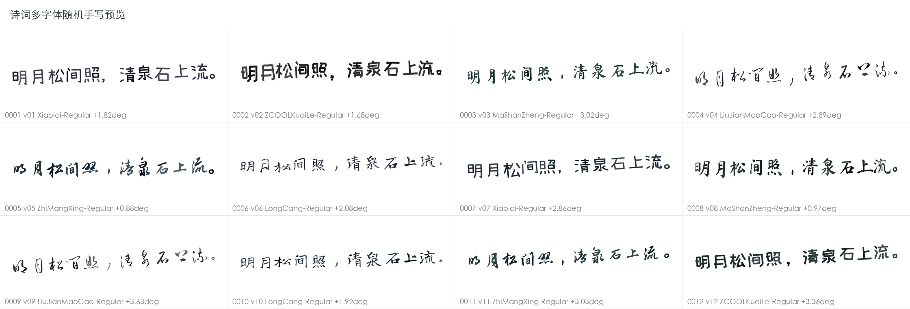
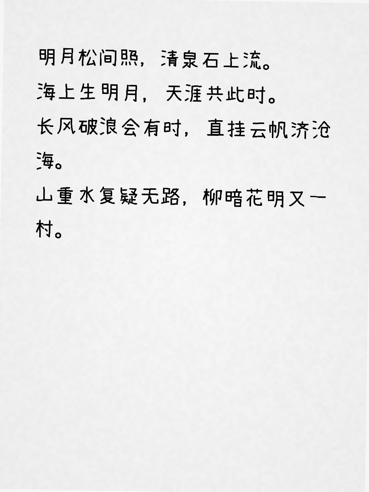

# 中文手写体生成 Skill

一个可离线运行、可复现、适合批量生成的中文手写体 Codex Skill。它支持短文本多版本、表格字段批处理、整页排版、字体对比，以及扫描/复印效果。

核心字体直接随仓库保存，不依赖原先参考项目、网页服务或运行时下载。所有公开演示和测试数据均为公版古诗词。





## 特性

- 6 款风格有区分的中文 OFL 字体：厚重题字、自然随写、行书、草写、活泼展示、圆润日常手写。
- `balanced`、`random`、`fixed` 三种字体分配策略。
- `subtle`、`natural`、`strong`、`note` 四档形变预设。
- 字符级字号、位置、间距和旋转扰动；整体可向右上、平直或向右下倾斜。
- 白底/自定义底色、整页横线/方格纸、PNG/PDF、扫描/复印/手机扫描效果。
- 固定 seed 可复现；字体与许可证 SHA-256 校验；生成后可验证 manifest。
- 默认 minimal manifest 不保存原文、原始记录 ID 或扫描源文件名。

## 安装

仓库根目录本身就是 Skill。个人使用时，可将仓库克隆到 Codex Skill 目录：

```bash
git clone <your-repository-url> ~/.codex/skills/chinese-handwriting-generator
cd ~/.codex/skills/chinese-handwriting-generator
python3 -m pip install -r requirements.txt
```

如果当前 Python 已有兼容版本的 Pillow，可跳过安装依赖。

## 快速体验

先检查内置字体对诗词字符的覆盖：

```bash
python3 scripts/handwriting_cli.py inspect-font \
  --text '明月松间照，清泉石上流。'
```

生成 12 个多字体随机版本：

```bash
python3 scripts/handwriting_cli.py render \
  --text '明月松间照，清泉石上流。' \
  --variants 12 --preset natural --trend up \
  --output out/poem-line
```

批量生成示例诗句：

```bash
python3 scripts/handwriting_cli.py batch \
  --input examples/poems.json --field text --variants 2 \
  --font-policy balanced --output out/poems
```

比较全部内置字体与形变档位：

```bash
python3 scripts/handwriting_cli.py compare \
  --text '海上生明月，天涯共此时。' \
  --output out/font-comparison \
  --preview-title '诗词手写字体对比'
```

整页和扫描效果请见 [模式与自定义说明](references/modes-and-config.md)。

## 字体策略

不传字体参数时，CLI 自动使用内置字体。显式传入 `--font` 或 `--font-dir` 时，只使用用户授权的外部字体；加 `--include-bundled-fonts` 才会合并两类字体。

| 字体 | 主要角色 | 许可证 |
|---|---|---|
| Ma Shan Zheng | 厚重题字 | OFL-1.1 |
| Long Cang | 自然随写 | OFL-1.1 |
| Zhi Mang Xing | 行书 | OFL-1.1 |
| Liu Jian Mao Cao | 草写 | OFL-1.1 |
| ZCOOL KuaiLe | 活泼展示 | OFL-1.1 |
| Xiaolai | 圆润日常手写与广字符兜底 | OFL-1.1 |

字体来源、固定版本、字体哈希和许可证哈希见 [字体清单](assets/fonts/fonts-manifest.json) 与 [第三方声明](THIRD_PARTY_NOTICES.md)。来源不明或没有字体专用再分发许可的测试字体不进入仓库。

## 开源边界

- 项目自有代码和文档：Apache License 2.0。
- `scripts/vendor/handrightbeta/`：原 BSD 3-Clause License。
- `assets/fonts/`：每款字体各自的 SIL Open Font License 1.1。
- 生成图片不会仅因使用 OFL 字体而自动变成 OFL；使用者仍需对输入文本、背景素材和具体用途负责。

字体二进制总量约 40 MiB，直接提交普通 Git，避免 Git LFS 指针或外部下载服务破坏离线可用性。

## 安全边界

本项目用于通用手写视觉模拟，不用于仿冒特定真人的签名、授权、收据、考勤、支付、合同或其他高后果身份凭证。详细规则见 [质量与安全说明](references/quality-and-safety.md)。

## 开发

```bash
python3 -m unittest discover -s tests -v
python3 -m py_compile scripts/handwriting_cli.py
```

贡献字体前请先阅读 [CONTRIBUTING.md](CONTRIBUTING.md)。
